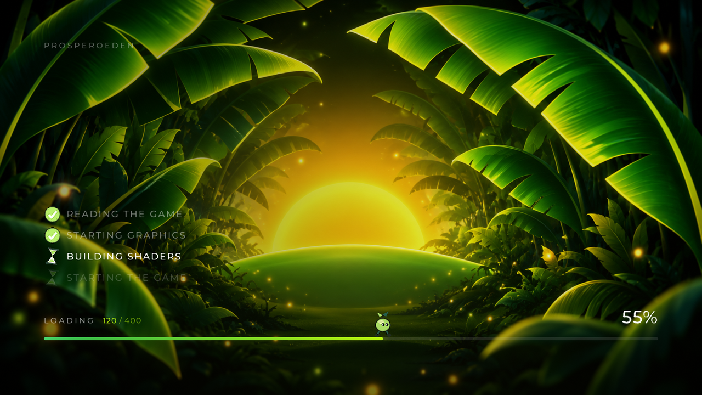

  

<h1 align="center">ProsperoEden – Switch UI</h1>

  <strong>Launcher y pantalla de carga al estilo del menú HOME de la Switch para <a href="https://github.com/blackbearreloaded/ProsperoEden">ProsperoEden</a> (PS5)</strong>

  
  

> [!NOTE]
> Versión **no oficial**, hecha por la comunidad, sobre **ProsperoEden v1.000.110**. No está hecha ni respaldada por
> BlackBearReloaded, el equipo de Eden, Sony ni Nintendo, y **no incluye contenido de Nintendo**. El emulador y todo
> lo demás es el proyecto original: [blackbearreloaded/ProsperoEden](https://github.com/blackbearreloaded/ProsperoEden).

## Qué añade

- **Home en carrusel**: todos tus juegos en una fila de carátulas, el último jugado primero. ←/→ para moverte,
  L1/R1 para pasar página, ✕ para jugar, △ para los ajustes del juego, □ para sus mods.
- **Barra superior** con el perfil, los mandos conectados y la hora, y **botones de sistema** redondos
  (Perfiles, Ajustes, Acerca de).
- **Pantalla de arranque** con la carátula del juego sobre su imagen difuminada.
- **Pantalla de carga** con imagen de fondo, un personaje que camina sobre la barra y un icono animado
  por cada paso. Funciona en Vulkan y en OpenGL.

## Instalar

Necesitas lo mismo que para ProsperoEden (una PS5 con homebrew, tus claves, firmware y juegos): sigue su
[README](https://github.com/blackbearreloaded/ProsperoEden#readme).

1. Descarga el ZIP de la [última release](../../releases/latest) y descomprímelo.
2. Cierra ProsperoEden en la PS5 y copia la carpeta `PPSA99008` **entera** a `/data/homebrew/PPSA99008` por FTP,
   sobrescribiendo. Comprueba que `eboot.bin` se haya reemplazado: si falla porque la app estaba abierta, se queda el viejo.
3. Abre ProsperoEden. Tus partidas y ajustes se conservan.

> [!WARNING]
> ProsperoEden avisa al abrirse cuando hay una versión oficial nueva. **Si aceptas instalarla, sustituye esta
> versión** (tus datos se conservan, el tema no). Para seguir con él, elige **Omitir** (*Skip* en inglés) en ese aviso.

## Guía completa

**[docs/SWITCH-UI.md](docs/SWITCH-UI.md)** (en español): versiones con las que está hecha, programas de Windows que
necesitas, cómo compilarla, y cómo cambiar sonidos, fondos, icono y sprites para dejarla a tu gusto.

## Problemas y reportes

Los issues de este repositorio están desactivados. Un problema del emulador o de un juego se reporta en el
[proyecto original](https://github.com/blackbearreloaded/ProsperoEden/issues).

## Créditos y licencia

- Basado en [ProsperoEden](https://github.com/blackbearreloaded/ProsperoEden) de BlackBearReloaded y en
  [Eden](https://github.com/eden-emulator/mirror), con el trabajo de Mihawk
  ([PS5 Mesa](https://github.com/mihawk-99/PS5_Mesa) y [PS5 Vulkan](https://github.com/mihawk-99/PS5_Vulkan)),
  [ps5-opengl](https://github.com/blackbearreloaded/ps5-opengl) y el resto de proyectos que cita su README, donde está
  la lista completa de créditos y agradecimientos.
- Licencia **GPL-3.0-or-later**, igual que el original (ver [LICENSE](LICENSE) y
  [THIRD_PARTY_NOTICES.md](THIRD_PARTY_NOTICES.md)): puedes usarlo, modificarlo y compartirlo con su código fuente y
  esta misma licencia.
- ProsperoEden no incluye claves, firmware, juegos ni otros datos con copyright de la consola: obtenlos de hardware
  y software que poseas. Nintendo y Switch son marcas de Nintendo; este proyecto no tiene relación con ella.
