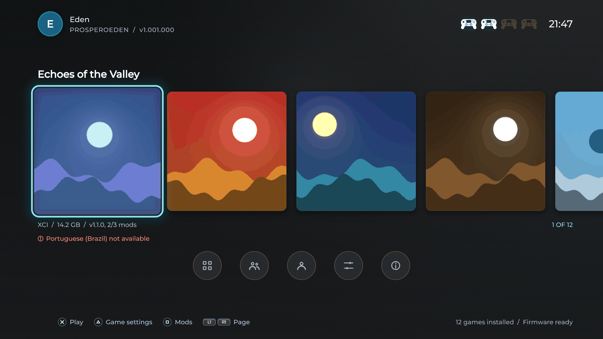
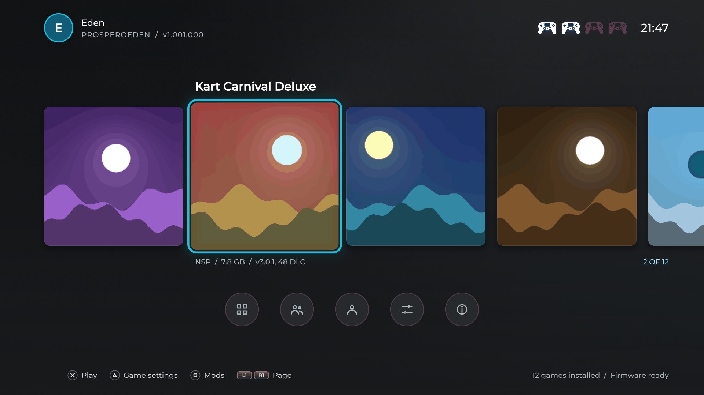
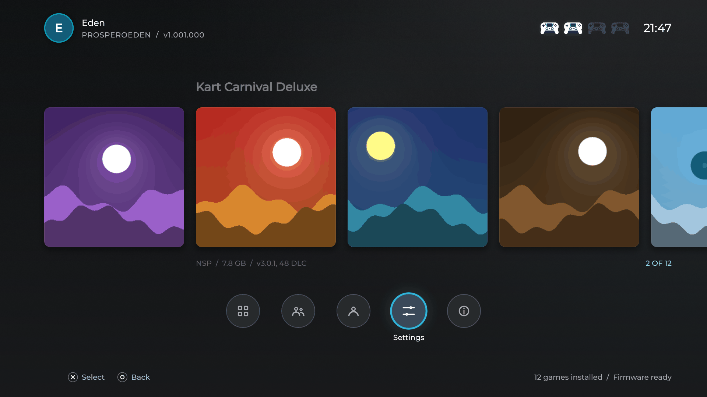
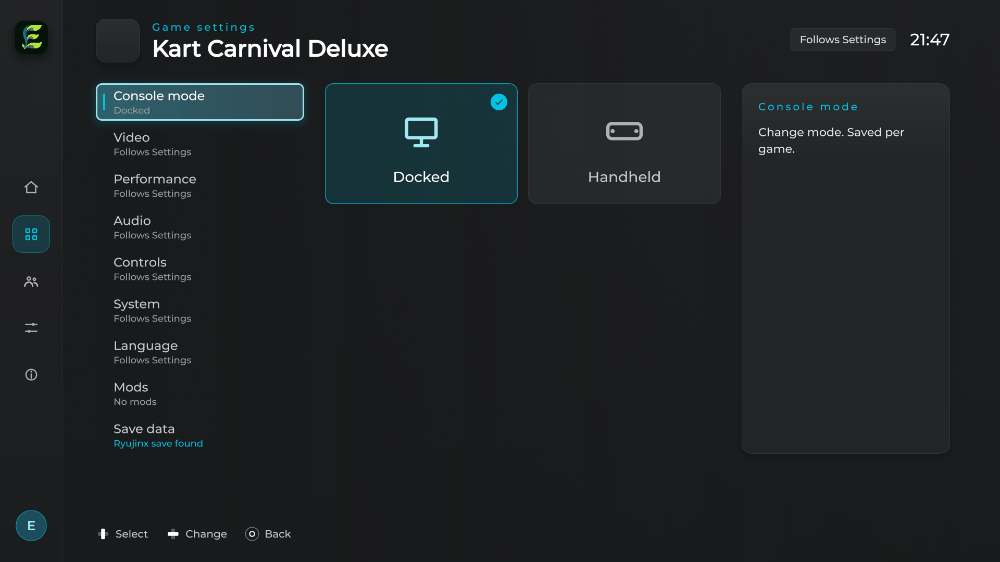
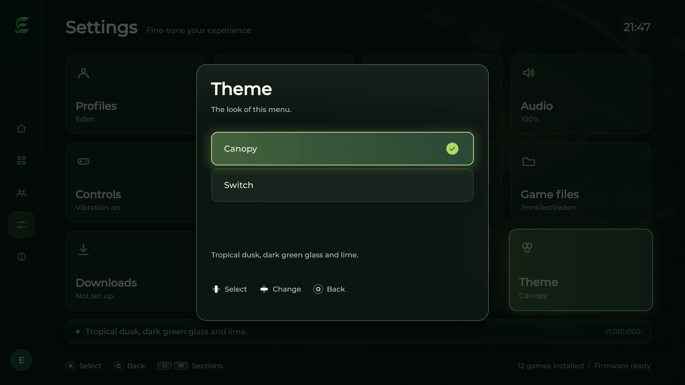
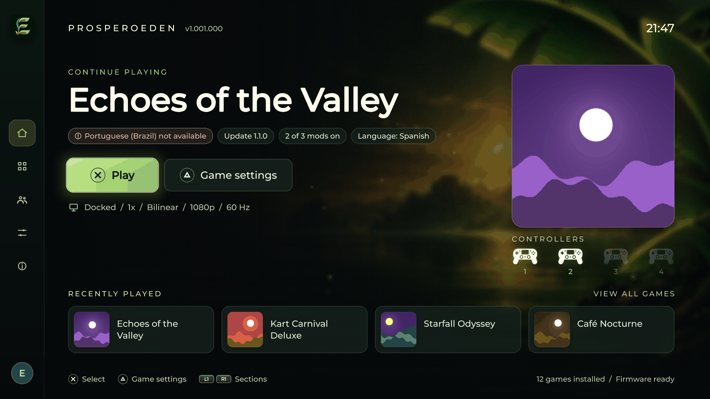
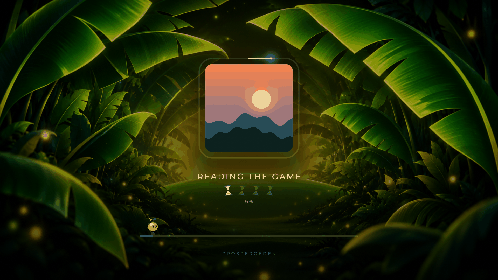
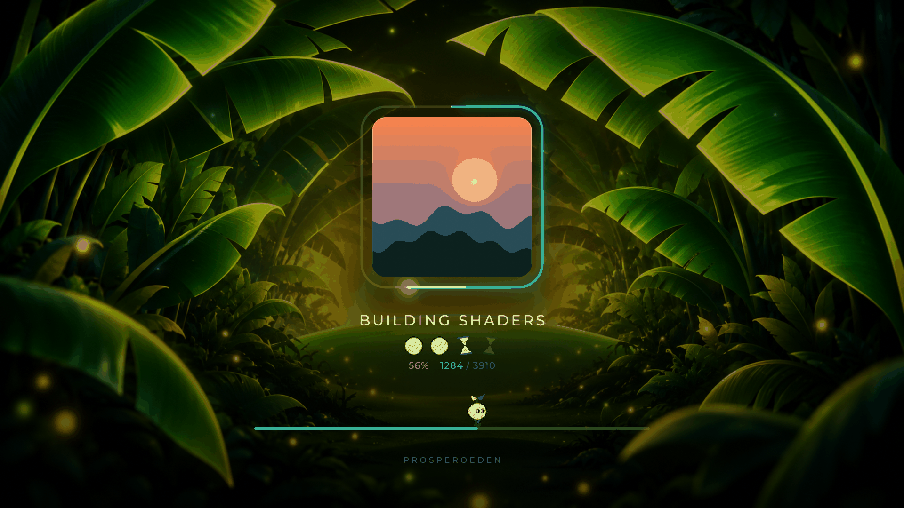
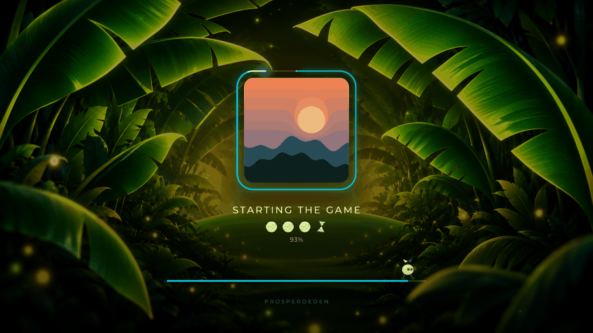

# ProsperoEden – Switch UI

Versión **no oficial** de [ProsperoEden](https://github.com/blackbearreloaded/ProsperoEden) con un
launcher al estilo del menú HOME de la Switch. Es gratuita y su código es GPL-3.0, como el original.
No está hecha ni respaldada por BlackBearReloaded, el equipo de Eden, Sony ni Nintendo.

## Qué cambia

Desde la v1.001.000, ProsperoEden tiene **temas** (Ajustes > Tema). Esta versión añade el tema
**Switch** y lo deja **por defecto**; el tema oficial, **Canopy**, sigue ahí y se puede elegir en
cualquier momento. El cambio se ve al instante: colores, fondo, icono y sonidos.

Con el tema Switch:

- **Home en carrusel**: todos tus juegos en una fila de carátulas cuadradas, empezando por el último
  que jugaste. ←/→ (cruceta o stick) para moverte, L1/R1 para pasar página, ✕ para jugar,
  △ para los ajustes del juego (el modo Docked/Handheld es su primera fila) y □ para activar o
  desactivar sus mods.
- **Barra superior** con el perfil que juega (avatar con su inicial), la versión, los mandos
  conectados y la hora.
- **Botones redondos** bajo el carrusel en lugar de la barra lateral: Biblioteca, Multijugador,
  Perfiles, Ajustes y Acerca de (↓ para llegar a ellos, ↑ o ○ para volver). La barra lateral vuelve
  en las demás pantallas.
- **Colores** gris oscuro plano con la selección en cian, y **sonidos, fondo e icono propios** del tema.
- **Pantalla de carga** del juego con:
  - una imagen de fondo;
  - un icono animado por cada paso de la carga, en lugar de las cuatro rayitas: tenue mientras
    espera, animado mientras trabaja y otro icono cuando ha terminado;
  - una barra de progreso abajo con un personaje que camina sobre su punta.

  La portada del juego con su línea de luz, el nombre del paso y el porcentaje son los de la
  pantalla de carga oficial de la v1.001.000. Funciona en los dos renderizadores, Vulkan y OpenGL.

Con el tema Canopy, ProsperoEden se ve como el original.

## Capturas

Son del launcher dibujado en el PC con juegos de ejemplo (`tools/launcher/preview.sh`) y de la
pantalla de carga (`tools/launcher/loading-preview.sh`), con el mismo código, shaders y fuente que
en la consola.

| | |
|---|---|
|  |  |
| El carrusel de juegos: el último jugado primero | Moverse por él; la tarjeta elegida crece y se ilumina |
|  |  |
| Los botones bajo el carrusel (↓): su nombre sale al elegirlos | △: ajustes del juego; el modo Docked/Handheld es la primera fila |
|  |  |
| Ajustes > Tema: Switch o Canopy | El home oficial, con el tema Canopy |
|  |  |
| La carga al empezar: el primer paso en curso (reloj de arena) | Compilando shaders: dos pasos hechos (visto) y uno en curso |
|  | |
| El último paso: el personaje llega casi al final de la barra | |

> [!IMPORTANT]
> **Este repositorio no incluye contenido de Nintendo ni de terceros.** Los sonidos son los del
> ProsperoEden original, el fondo del tema es un degradado gris generado por
> `tools/launcher/render-art.py`, la imagen de la pantalla de carga es la del original y los sprites
> (un brote que camina y un reloj de arena) son propios. Puedes poner los tuyos siguiendo esta
> guía. Si usas imágenes, música o sonidos de Nintendo, hazlo **solo en tu consola**: no los subas
> ni los compartas, y no los incluyas en una release.

> [!WARNING]
> ProsperoEden avisa al abrirse cuando hay una versión oficial nueva. **Si aceptas instalarla,
> sustituye esta versión** (tus partidas y ajustes se conservan, el tema no). Para seguir con este
> tema, elige **Omitir** (*Skip* en inglés) en ese aviso y actualiza con un build de esta rama (ver [Actualizar](#actualizar-a-una-versión-nueva-de-prosperoeden)).

---

## Versiones con las que está hecha y probada

| | |
|---|---|
| **Proyecto base** | [ProsperoEden de BlackBearReloaded](https://github.com/blackbearreloaded/ProsperoEden) |
| **Versión base** | **v1.001.000** (tag `v1.001.000`, commit `d7f2764`; `contentVersion` 01.001.000) |
| **Firmware de la PS5 en el que se probó el tema** | **12.20** (`sdk_version 0x12200005`), con el renderizador Vulkan |
| Firmwares de PS5 que el proyecto original menciona en sus notas | 6.02, 7.40, 7.61, 12.70 y 13.60 |

El tema **solo se ha probado en el firmware 12.20**, con el renderizador Vulkan. Lo probado en la
consola es el paquete del autor, con sus propios sonidos, fondos y sprites; el de este repositorio
tiene el mismo código y solo cambian esos archivos (sus pantallas se han comprobado dibujándolas en
el PC). En otros firmwares funciona el launcher que ya traía el proyecto original, pero no se ha
comprobado que el tema se vea igual. Las novedades y los problemas de cada firmware están en el
[README](https://github.com/blackbearreloaded/ProsperoEden#readme) y en las
[releases](https://github.com/blackbearreloaded/ProsperoEden/releases) del proyecto original.

No tienes que elegir ni instalar las versiones de Eden y de las librerías: el propio proyecto las
**fija** en `tools/deps.json` y `make` las descarga solas, comprobando su hash. Son estas:

| Pieza | Versión fijada |
|---|---|
| **Eden** (el emulador) | commit `67bada77f8a43a90da2e94e89b8e7da73c256989` del [mirror](https://github.com/eden-emulator/mirror) |
| FFmpeg | commit `c7b5f1537d9c52efa50fd10d106ca015ddde1818` |
| PS5 OpenGL SDK | **1.0.2** |
| PS5 Payload SDK | v0.42 |
| fmt / HarfBuzz / compiler-rt | 12.1.0 / 12.3.2 / LLVM 18.1.8 |
| PS5 Mesa y Vulkan (Mihawk) | commits `7b59ef2` (Mesa), `5b5e4fc` (Vulkan), `b83202b` (Payload SDK) |
| Helper de acceso (Lapy) | commit `57fcc19` |
| UI kit ([ps5-homebrew-ui](https://github.com/blackbearreloaded/ps5-homebrew-ui)) | commit `aed286b` (de él salen las recetas de los temas) |

Con qué lo compilamos en Windows 11 + WSL 2:

| Herramienta | Versión usada |
|---|---|
| Ubuntu (WSL) | 24.04 |
| CMake | **3.31.6** (la 3.28 de Ubuntu 24.04 no sirve) |
| LLVM / Clang | 18 y 21 (el script de Ubuntu 24.04 instala el 21) |
| Python en Windows | 3.14, con Pillow 12 |
| FFmpeg en Windows | 8.1 |
| texconv | el último de DirectXTex (firmado por Microsoft) |

Si usas otra versión de ProsperoEden o de Eden, lo más probable es que los cambios de esta guía
necesiten ajustes (ver [Actualizar](#actualizar-a-una-versión-nueva-de-prosperoeden)).
Para ver lo que tienes en tu copia: `make deps-status` lista cada pieza y si coincide con su versión
fijada.

---

## 1. Instalarla en la PS5 (sin compilar nada)

Necesitas lo mismo que para el ProsperoEden original (su
[README](https://github.com/blackbearreloaded/ProsperoEden#readme) explica la preparación de la PS5,
las claves, el firmware y los juegos): una PS5 con homebrew y un servidor FTP en la consola.

1. Descarga el ZIP de la release y descomprímelo: dentro hay una carpeta `PPSA99008`.
2. Cierra ProsperoEden en la PS5.
3. Con un cliente FTP (FileZilla o WinSCP, ver los [programas](#2-programas-para-windows)), copia
   la carpeta **entera** a `/data/homebrew/PPSA99008` y sobrescribe lo que haya. Comprueba que
   `eboot.bin` se haya reemplazado: si falla porque la app estaba abierta, se queda el viejo.
4. Abre ProsperoEden. Si ya lo usabas con el tema Canopy, elige **Ajustes > Tema > Switch** (una
   instalación nueva abre ya con Switch).

---

## 2. Programas para Windows

Para **personalizar** el tema (sonidos, fondos, sprites) y **compilar** tu propia versión.

| Programa | Para qué | Cómo instalarlo |
|---|---|---|
| **WSL 2 + Ubuntu** | Compilar ProsperoEden (solo compila en Linux) | En PowerShell como administrador: `wsl --install -d Ubuntu-24.04` y reinicia |
| **Windows Terminal** | Usar Ubuntu y PowerShell cómodamente | Viene con Windows 11; si no: `winget install Microsoft.WindowsTerminal` |
| **Git** | Descargar el código | `winget install Git.Git` (y `sudo apt install git` en Ubuntu) |
| **FFmpeg** | Convertir sonidos e imágenes | `winget install Gyan.FFmpeg` |
| **Python 3.12 o superior + Pillow** | Generar fondos y sprites | `winget install Python.Python.3.13`, luego `py -m pip install pillow` |
| **texconv** (Microsoft DirectXTex) | Crear los fondos del home de la PS5 (`pic0.dds`, `pic1.dds`) | Descarga `texconv.exe` de [DirectXTex releases](https://github.com/microsoft/DirectXTex/releases) |
| **FileZilla** o **WinSCP** | Copiar la carpeta a la PS5 por FTP | `winget install TimKosse.FileZilla.Client` o `winget install WinSCP.WinSCP` |
| Editor de imágenes (opcional) | Preparar tus sprites con fondo transparente | GIMP, Paint.NET, Photoshop… |

Truco: activa en el Explorador **Ver > Mostrar > Extensiones de nombre de archivo**. Si no, es
fácil acabar con archivos como `fondo.jpg.jpg` sin darte cuenta.

Desde el Explorador de Windows, la carpeta de Ubuntu se abre escribiendo `\\wsl.localhost\Ubuntu-24.04\home\TU_USUARIO`
en la barra de direcciones (el nombre de la distribución puede ser solo `Ubuntu`).

---

## 3. Compilar

Todo esto va **en la terminal de Ubuntu (WSL)**, no en PowerShell. Trabaja dentro de tu carpeta
de Linux (`~`), no en `/mnt/c/...`: compilar sobre el disco de Windows es muchísimo más lento.

### 3.1 Herramientas de Ubuntu

Las documenta el proyecto en [BUILDING.md](BUILDING.md):

- **Ubuntu 26.04** (recomendado por el proyecto):
  ```bash
  sudo apt update && sudo apt install --no-install-recommends $(grep -v '^#' tools/ci/ubuntu-packages.txt)
  ```
- **Ubuntu 24.04** (el de `wsl --install` hoy): el proyecto trae un script que añade lo que le falta
  (LLVM 21, Meson y el traductor SPIR-V, que compila; tarda un rato). Se ejecuta desde la carpeta
  del repositorio, después de clonarlo ([3.2](#32-descargar-y-compilar)):
  ```bash
  sudo apt update && bash tools/ci/setup-ubuntu-24.04.sh ~/spirv-llvm-translator
  ```
  Y deja estas dos variables para el build; guárdalas en `~/.bashrc` para no repetirlas:
  ```bash
  echo 'export PKG_CONFIG_PATH="$HOME/spirv-llvm-translator/lib/pkgconfig" LLVM_CONFIG=/usr/bin/llvm-config-21' >> ~/.bashrc && source ~/.bashrc
  ```
  Además Ubuntu 24.04 trae **CMake 3.28** y Eden necesita **3.31 o superior** (ver
  [Problemas frecuentes](#5-problemas-frecuentes)).

Para la vista previa del launcher en el PC hacen falta también:

```bash
sudo apt install g++ libegl-dev libgl-dev
```

Comprueba que no falta nada:

```bash
make toolchain
```

### 3.2 Descargar y compilar

```bash
git clone -b switch-ui-public-1001 https://github.com/ophielsamael/ProsperoEden-SwitchUI ~/ProsperoEden
```

(`switch-ui-public-1001` es la rama con esta versión, sobre la v1.001.000 del proyecto base.)

```bash
cd ~/ProsperoEden && make package
```

- La **primera vez tarda bastante** (descarga y compila RADV, FFmpeg y Eden). Las siguientes
  reutilizan la caché y van mucho más rápido.
- El resultado es la carpeta `~/ProsperoEden/build/release/PPSA99008`: cópiala a la consola como
  en el [paso 1](#1-instalarla-en-la-ps5-sin-compilar-nada), o con `make install PS5_HOST=<IP de la PS5>`.
- `make` a secas también crea el ZIP de release en `dist/`.

### 3.3 Ver el launcher en el PC antes de copiarlo

```bash
PE_THEME=switch bash tools/launcher/preview.sh build/launcher-preview
```

Dibuja las pantallas del launcher con juegos de ejemplo en `build/launcher-preview/*.png`, con el
tema Switch (sin `PE_THEME`, con Canopy). El recorrido de la vista previa está pensado para el home
oficial: con el tema Switch acaba diciendo que algunas comprobaciones fallaron (`error: ... did not
reach the settings`), y las capturas del final no muestran lo que dicen sus nombres. Las primeras
(`01-home.png`, `02-…`, `03-…`) sí son el carrusel.

La pantalla de carga, con la imagen y los sprites del tema:

```bash
PE_LOADING_PICTURE=headless/prosperoeden/ui/art/switch-loading.tga PE_LOADING_SPRITES=1 PE_LOADING_PALETTE=00c3e3,9fe9f5,0b5f78,1b1c1e bash tools/launcher/loading-preview.sh build/loading-preview
```

---

## 4. Personalizarlo (para dejarlo como el del autor)

Cada cosa tiene un **archivo fuente** que pones tú y un paso que lo convierte al formato que usa la
consola. Después de cambiar cualquier cosa: `make package` y copia la carpeta a la PS5.

En los comandos de abajo, `py` es Python de Windows y se ejecuta en PowerShell desde la carpeta del
repositorio (`\\wsl.localhost\Ubuntu-24.04\home\TU_USUARIO\ProsperoEden`); también puedes usar el
`python3` de Ubuntu si tiene Pillow.

Todo lo de este apartado es del tema **Switch**: el tema Canopy sigue con lo suyo.

### 4.1 Sonidos del menú

Carpeta `headless/prosperoeden/ui/sounds/switch/` (créala). Si no existe o está vacía, el tema usa
los sonidos del launcher (`ui/sounds/`). Cada sonido es `<nombre>_NN.wav` (`NN` desde `01`; con
varios, se alternan). Formato **WAV PCM 16 bits, 48 000 Hz**, mono o estéreo. Pon todos los de la
lista: si la carpeta existe, solo se usan los suyos.

| Archivo | Cuándo suena |
|---|---|
| `focus_01.wav`, `focus_02.wav` | Mover la selección |
| `select_01.wav` | Confirmar con ✕ en los menús |
| `back_01.wav` | Volver con ○ |
| `page_01.wav` | Pasar página (L1/R1) |
| `open_01.wav` | Abrir una pantalla |
| `modal_open_01.wav`, `modal_close_01.wav` | Abrir y cerrar un diálogo |
| `toggle_01..03.wav` | Cambiar un interruptor o una opción |
| `slider_01..03.wav` | Mover un nivel (volumen, etc.) |
| `saved_01.wav` | Algo se guardó, un mando se conectó |
| `error_01.wav` | Acción no disponible |
| `notify_01.wav` | Aviso |
| `launch_01.wav` | Arrancar un juego |
| `welcome_01.wav` | Abrir la app |
| `resume_01.wav` | Volver al launcher tras un juego |

Convertir cualquier sonido (MP3, WAV, OGG…) con FFmpeg:

```powershell
ffmpeg -i "mi sonido.mp3" -ar 48000 -c:a pcm_s16le -map_metadata -1 headless/prosperoeden/ui/sounds/switch/select_01.wav
```

Si los niveles quedan muy distintos entre sí, `tools/launcher/process-sfx.py` los recorta e iguala
(necesita `numpy`).

### 4.2 Fondo, logo y fondo de carga del tema

Tres archivos fuente en `sce_sys/`:

| Fuente | Qué es |
|---|---|
| `switch-background-source.png` | El fondo del launcher (16:9; 3840×2160 ideal). Se oscurece hacia la izquierda |
| `switch-icon-source.png` | El logo del launcher (cuadrado): en la barra lateral y en los juegos sin carátula |
| `switch-loading-source.png` | La imagen de la pantalla de carga (16:9) |

Los tres se convierten de una vez:

```powershell
py tools/launcher/render-art.py switch
```

Escribe `switch-backdrop.tga`, `switch-backdrop-blur.tga`, `switch-brand.tga` y `switch-loading.tga`
en `headless/prosperoeden/ui/art/`.

En la pantalla de carga, **la portada del juego va en el centro**, el texto debajo y la barra cerca
del borde inferior: pon lo importante de la imagen (un logo, personajes) en las esquinas o a los
lados. Se oscurece un poco para que se lea el texto.

**Para quitar la imagen de carga**, borra `ui/art/switch-loading.tga` (en la carpeta de la consola o
antes de compilar): la pantalla de carga vuelve al fondo de colores de la portada del original, y los
sprites ([4.5](#45-sprites-de-la-pantalla-de-carga)) se siguen dibujando.

### 4.3 Icono y fondos del home de la PS5

Al seleccionar la app en el home de la PS5 (no son del tema: se ven sea cual sea):

- `sce_sys/icon0.png`: el icono, **512×512 PNG**, se usa tal cual.
- `sce_sys/pic0.dds`: la imagen de fondo; también es la imagen con la que se abre el launcher.
- `sce_sys/pic1.dds`: la imagen al abrirla.

Las dos son texturas **3840×2160 en BC7**, sin mipmaps. Escala y recorta tus imágenes y comprímelas con texconv:

```powershell
ffmpeg -i mi-fondo.png -vf "scale=3840:2160:force_original_aspect_ratio=increase:flags=lanczos,crop=3840:2160" pic0.png
ffmpeg -i mi-fondo-al-abrir.png -vf "scale=3840:2160:force_original_aspect_ratio=increase:flags=lanczos,crop=3840:2160" pic1.png
texconv -y -f BC7_UNORM -m 1 -o sce_sys pic0.png pic1.png
```

### 4.4 Música del home de la PS5

`sce_sys/snd0.at9` suena al seleccionar la app en el home. Tiene que ser **ATRAC9** (48 kHz,
estéreo, 192 kbps) y pesar **2 MB como máximo** (unos 85 s). No existe un codificador ATRAC9 libre:
solo lo hace `at9tool`, del SDK oficial de Sony, que no se distribuye públicamente. FFmpeg puede
preparar el audio (recortado y con fundido), pero no convertirlo a ATRAC9.

### 4.5 Sprites de la pantalla de carga

Carpeta `headless/prosperoeden/ui/art/`. PNG con **fondo transparente**, el personaje con los pies
abajo; 128×128 funciona bien. Se reducen solos (a 32×48 y 26×28 píxeles, 15 colores cada grupo), así
que conviene que sean dibujos claros, de colores planos y con contorno.

| Archivo | Qué es |
|---|---|
| `walker_0.png`, `walker_1.png` | El personaje que camina sobre la barra: se alternan cada 180 ms |
| `mark_busy_0.png`, `mark_busy_1.png` | En el sitio de un paso: `_0` tenue mientras espera; se alternan cada 100 ms mientras trabaja |
| `mark_done.png` | En el sitio de un paso terminado |

Después de cambiarlos, regenera el shader (`headless/loading_sprite.glsl`):

```powershell
py tools/launcher/bake-loading-sprite.py
```

Ejemplo del autor: un Koopa caminando (2 dibujos) como `walker_*`, Luigi asustado con su linterna
(2 dibujos) como `mark_busy_*` y Luigi con el pulgar arriba como `mark_done`.

### 4.6 Colores y lo demás del tema

Están en `headless/prosperoeden/pe/ui/theme.cpp`, en la función `switch_theme()`: los colores de
fondo, paneles, texto y acento (`t.accent` es el cian de la selección), las esquinas, los nombres de
los archivos de arte, la carpeta de sonidos y si el home es el carrusel (`t.carousel_home`). Qué es
cada cosa lo explica [docs/THEMES.md](THEMES.md) (en inglés). Si cambias el texto `t.summary`, el
build pide su traducción en todos los idiomas (`tools/launcher/strings.py check`).

---

## 5. Problemas frecuentes

| Problema | Solución |
|---|---|
| `apt` dice *unmet dependencies* | `sudo apt update` y `sudo apt --fix-broken install -y`, y vuelve a instalar |
| `CMake 3.31 or higher is required. You are running version 3.28.3` | Instala CMake 3.31 en tu usuario y enlázalo en `/usr/local/bin`, porque los scripts de compilación usan solo las carpetas del sistema (ver abajo) |
| `preview.sh: Permission denied` | Ejecútalo con `bash tools/launcher/preview.sh …` |
| No encuentra tu imagen | Revisa que no se llame `imagen.jpg.jpg` (activa las extensiones en el Explorador) |
| Sale el home oficial y no el carrusel | Elige **Ajustes > Tema > Switch** |
| La pantalla de carga sale sin la imagen | No encontró `ui/art/switch-loading.tga`; en `stderr.log` (`/data/prosperoeden/logs/`) busca `EDEN_LOADING the theme's picture` |
| Un recuadro "Optimised for Game settings" arriba | Es el aviso de modo juego (ALLM) de algunos televisores, no de la app: se quita en los ajustes de la tele |

CMake 3.31 en Ubuntu 24.04:

```bash
mkdir -p ~/.local && curl -L https://github.com/Kitware/CMake/releases/download/v3.31.6/cmake-3.31.6-linux-x86_64.tar.gz | tar -xz -C ~/.local --strip-components=1
```

```bash
sudo ln -sf ~/.local/bin/cmake ~/.local/bin/ctest ~/.local/bin/cpack /usr/local/bin/
```

---

## Actualizar a una versión nueva de ProsperoEden

Los cambios de esta versión están en la rama `switch-ui-public-1001`, sobre la v1.001.000 del
proyecto. Las ramas `switch-ui-public` (v1.000.100) y `switch-ui-public-110` (v1.000.110) son las
anteriores, con su propio launcher. Para llevar los cambios a una versión oficial nueva, abre la
terminal de Ubuntu (WSL) y **entra primero en la carpeta del proyecto**: los comandos de git solo
funcionan dentro de ella, y si los ejecutas desde `~` dan *fatal: not a git repository*.

```bash
cd ~/ProsperoEden
```

(Si lo clonaste en otro sitio, entra en esa carpeta; `git status` debe responder con el nombre de la rama,
no con un error.) Después, añade el proyecto original como `upstream` (solo la primera vez):

```bash
git remote add upstream https://github.com/blackbearreloaded/ProsperoEden
```

```bash
git fetch upstream --tags && git switch -c mi-actualizacion && git rebase upstream/main
```

Si git avisa de conflictos, son archivos que el proyecto también cambió:
- `theme.cpp`, `theme.hpp`, `frontend.cpp`: el tema y la carga de sus sonidos y su arte.
- `home_carousel.cpp`, `launcher.*`, `shell.cpp`, `library.cpp`: el carrusel.
- `loading_scene.glsl`, `loading_art.h`, `hud.h`: la pantalla de carga.
- Los `.po` de `ui/lang`: la descripción del tema en cada idioma.

Desde la v1.001.000 el tema está hecho para tocar lo menos posible del launcher oficial: el home
original sigue intacto y el carrusel es un archivo aparte, así que las próximas versiones deberían
dar menos conflictos. Para pasar de la v1.000.110 a la v1.001.000, en cambio, hubo que rehacerlo:
el proyecto cambió el launcher entero (temas, barra lateral, pantalla de carga nueva).

Resuélvelos y continúa con `git add <archivo>` y `git rebase --continue`.

Antes de compilar, mira si el proyecto fijó otras versiones de Eden o de sus librerías:

```bash
make deps-status
```

Las líneas `present at X, pinned Y` son copias que `make` no mueve solo: las de `../mihawk-*-review`
(Mesa, Vulkan y Payload SDK). Pasa cada una a su commit fijado:

```bash
git -C ../mihawk-mesa-review fetch origin && git -C ../mihawk-mesa-review checkout --detach <commit fijado>
```

(igual para `../mihawk-vulkan-review` y `../mihawk-sdk-review`; los commits están en
`tools/deps.json`). Después `make package` y copia la carpeta a la consola. Con un Mesa nuevo el
build reconstruye RADV, así que la primera compilación tarda bastante más.

---

## Créditos y licencia

- Basado en [ProsperoEden](https://github.com/blackbearreloaded/ProsperoEden) de BlackBearReloaded y
  en [Eden](https://github.com/eden-emulator/mirror); con el trabajo de Mihawk (PS5 Mesa/Vulkan), el
  UI kit [ps5-homebrew-ui](https://github.com/blackbearreloaded/ps5-homebrew-ui) y el resto de
  proyectos que lista su README.
- Licencia **GPL-3.0-or-later**, igual que el original: puedes usarlo, modificarlo y compartirlo,
  siempre con su código fuente y esta misma licencia.
- Nintendo, Switch y sus personajes son marcas de Nintendo. Este proyecto no está relacionado con
  Nintendo ni incluye su contenido.
